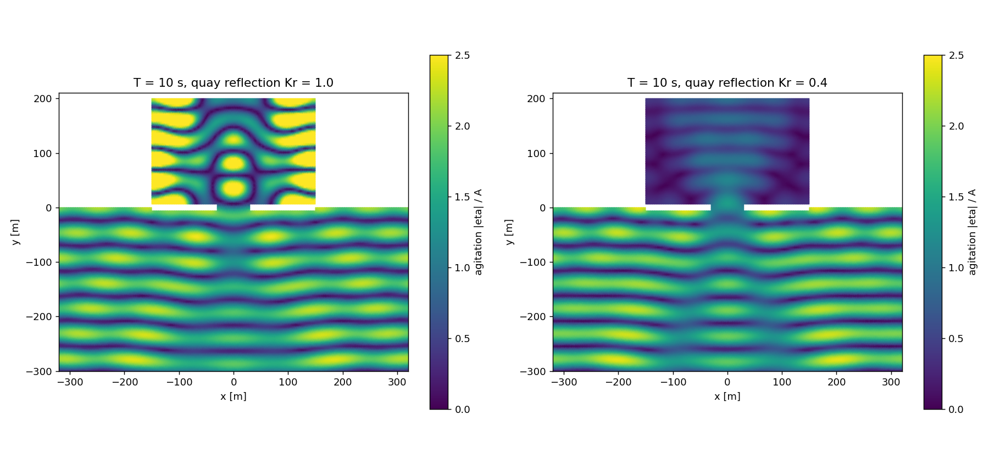
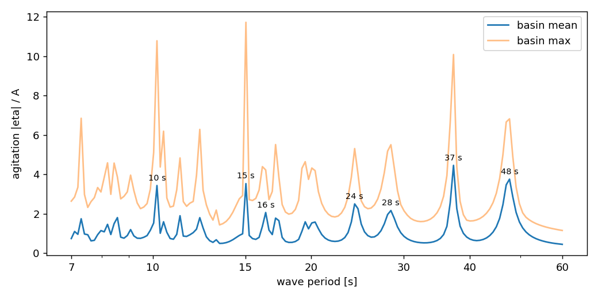
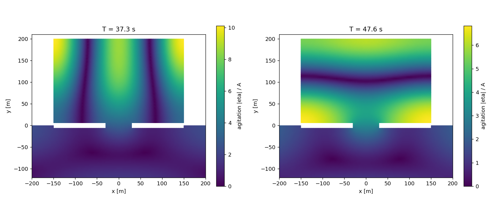
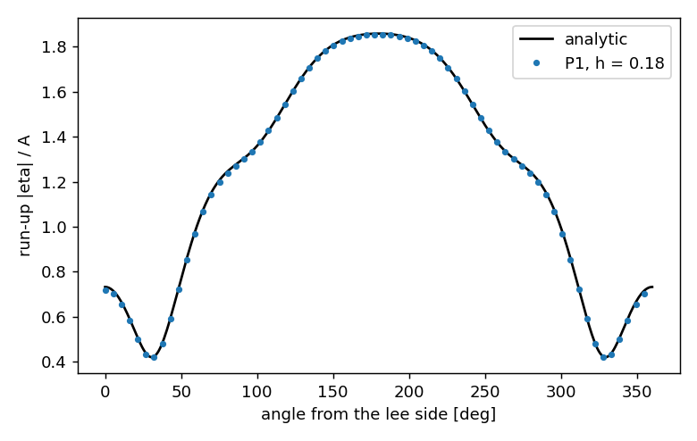

# harborwave

[](https://github.com/abderrazzak-elammari/harborwave/actions/workflows/ci.yml)


Agitation de la houle dans un port, calculée par l'équation de pente douce et des éléments
finis P1. NumPy et SciPy uniquement, mailleur compris. Vérifié contre la solution de
diffraction de MacCamy–Fuchs, avec l'ordre de convergence 2 attendu.



Port idéalisé sur une côte rectiligne, houle de 10 s arrivant de face. À gauche : quais
verticaux en béton (réflexion totale). À droite : les mêmes quais équipés de chambres
d'amortissement (coefficient de réflexion 0,4). L'agitation moyenne dans le bassin passe
de 1,59 à 0,49.

## Ce que fait le code

À partir d'une bathymétrie, d'un plan de port et d'une houle monochromatique incidente, le
code résout l'équation de pente douce de Berkhoff

$$
\nabla \cdot \left( c c_g \nabla \eta \right) + k^2 c c_g \eta = 0
$$

pour l'amplitude complexe $\eta$ de la surface libre, avec

- une frontière ouverte au large qui laisse sortir l'onde diffractée par le port
  (condition de Sommerfeld avec la correction de courbure de Bayliss–Turkel au premier
  ordre) ;
- des parois partiellement réfléchissantes, $\partial \eta / \partial n = i k \alpha \eta$, paramétrées par le
  coefficient de réflexion $K_r$ usuel de l'ouvrage (1 pour un mur vertical, 0,3 à 0,5 pour
  un enrochement ou un quai absorbant) ;
- une houle incidente écrite comme onde plane plus son image sur la côte, de sorte que seule
  la contribution du port a besoin de satisfaire la condition de rayonnement.

La sortie est le coefficient d'agitation $|\eta| / A$, la grandeur qu'un ingénieur côtier
utilise pour décider si un poste à quai est exploitable.

## Résultats

### Résonance du bassin

Balayage de la période de houle de 7 à 60 s (150 résolutions, 31 000 degrés de liberté,
0,5 s chacune) :



À ses périodes propres, le bassin amplifie la houle incidente d'un facteur 4 en moyenne et
10 localement. Les deux modes les plus bas :



### Vérification : diffraction par un cylindre vertical

En profondeur constante, l'équation de pente douce se réduit à l'équation de Helmholtz, et
la diffraction d'une onde plane par un cylindre vertical a une solution analytique
(MacCamy et Fuchs, 1954). Avec $ka = 2$ et la frontière ouverte à $kR = 16$ :

| n_radial | DDL | h | erreur L2 relative |
|---:|---:|---:|---:|
| 14 | 1 500 | 0,698 | 4,82e-01 |
| 28 | 5 829 | 0,351 | 1,33e-01 |
| 56 | 22 914 | 0,176 | 3,41e-02 |
| 112 | 90 852 | 0,088 | 8,69e-03 |

Ordre observé : **1,95**. Run-up autour du cylindre, la grandeur que lit le concepteur :



Les tests vérifient aussi la relation de dispersion contre ses limites en eau profonde et en
eau peu profonde, le shoaling d'une houle sur une pente 1:37 contre la conservation du flux
d'énergie (à 1 % près), et le fait que la correction de courbure réduit d'un facteur
supérieur à 5 la réflexion parasite de la frontière ouverte à `kR = 4`.

## Installation

```bash
git clone https://github.com/abderrazzak-elammari/harborwave
cd harborwave
pip install -e ".[dev]"
pytest
```

Pour reproduire les figures :

```bash
python examples/cylinder_verification.py
python examples/harbor_agitation.py
python examples/harbor_resonance.py      # environ une minute
```

Version interactive :

```bash
pip install -e ".[app]"
streamlit run app/streamlit_app.py
```

## Utilisation

```python
import numpy as np
from harborwave import Harbor, MildSlope, ReflectedPlaneWave, agitation, dispersion

harbor = Harbor(basin_length=300, basin_width=200, entrance=60, depth_basin=6)
mesh = harbor.mesh(period_min=7.0, nodes_per_wavelength=12)

model = MildSlope(
    mesh,
    harbor.depth(mesh.nodes),
    open={"offshore": 1 / harbor.radius},
    reflection={"coast": 1.0, "breakwater": 1.0, "quay": 0.4},
)

period = 12.0
k = float(dispersion.wavenumber(2 * np.pi / period, harbor.depth_sea))
eta = model.solve_period(period, ReflectedPlaneWave(k, angle=np.pi / 2))
print(agitation(eta)[harbor.basin_nodes(mesh)].max())
```

Toute géométrie convient dès lors qu'on sait écrire sa fonction distance signée et
échantillonner sa frontière ; voir `geometry.py` pour le port et `mesh.from_distance` pour
le mailleur.

## Organisation

```
src/harborwave/
    dispersion.py   relation de dispersion (Newton), vitesses de phase et de groupe
    mesh.py         maillages structurés, mailleur par fonction distance, extraction des bords
    fem.py          assemblage P1 vectorisé à coefficients par élément, en complexe
    waves.py        onde plane incidente, avec son image sur une côte rectiligne
    solver.py       équation de pente douce, frontières ouvertes et partiellement réfléchissantes
    geometry.py     port idéalisé : plan, bathymétrie, étiquetage des bords
    analytic.py     MacCamy–Fuchs, shoaling, estimation de la période de Helmholtz
    plotting.py     fonctions matplotlib
tests/              20 tests, environ 15 s
examples/           scripts qui produisent les figures ci-dessus
app/                démo Streamlit
```

## Limites

- Théorie linéaire : pas de déferlement, pas d'interaction houle–courant, houle
  monochromatique uniquement. Un spectre se traite en superposant des solutions à plusieurs
  périodes et directions.
- La condition de frontière ouverte est du premier ordre. Elle est précise pour `kR > 10` ;
  pour les longues périodes où se situe le mode de Helmholtz (pompage) de ce bassin (vers
  220 s d'après l'estimation à constantes localisées), il faudrait un domaine de plusieurs
  kilomètres, ou remplacer la condition par une PML ou un opérateur DtN.
- Le mailleur convient aux domaines dont les détails font quelques éléments de large. Pour
  un port réel au trait de côte complexe, générer le maillage avec gmsh et construire un
  `Mesh` à partir des tableaux de nœuds et de connectivité ; l'assemblage ne dépend pas de
  l'origine du maillage.

## Références

- Berkhoff, J. C. W. (1972). *Computation of combined refraction–diffraction.*
  Proc. 13th Int. Conf. Coastal Engineering.
- MacCamy, R. C. & Fuchs, R. A. (1954). *Wave forces on piles: a diffraction theory.*
  Beach Erosion Board, Tech. Memo 69.
- Bayliss, A., Gunzburger, M. & Turkel, E. (1982). *Boundary conditions for the numerical
  solution of elliptic equations in exterior regions.* SIAM J. Appl. Math.
- Mei, C. C. (1989). *The Applied Dynamics of Ocean Surface Waves.* World Scientific.

## Licence

MIT
